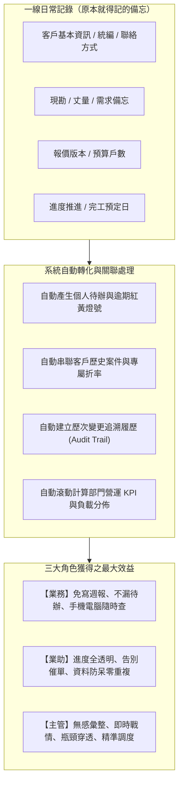

# 正道工業系統櫃事業部｜業務報價與案件時程追蹤系統
# 三大角色操作說明與效益最大化指南（業務／業助／主管）

---

## 導言：平台核心價值理念

在系統櫃接案與工程服務流程中，資訊往往高度碎片化——業務將案場現況記在隨身紙本、將尺寸存在手機備忘錄、將圖面與報價散落在 LINE 記事本與個人電腦 Excel 中。
這種傳統模式不僅耗時費力，更衍生出「業務忙於回報、業助忙於催單、主管忙於追問」的三角內耗。

本系統的核心設計理念即是：**「一次登打、自動沉澱、效益最大化」**。
將同仁**原本就必須記錄在紙本或手機裡的案場備忘資訊**，直接登記於本平台，系統即會**自動轉化為個人待辦事項、案場歷程軌跡、時程預警燈號，並即時滾動彙整為全事業部的營運統計數據與戰情看板**。

---

## 第一章：三大使用者角度之核心優勢與效益剖析

| 評估構面 | 業務專員 (Sales) | 業務助理 (Assistant) | 單位主管 (Manager) |
| :--- | :--- | :--- | :--- |
| **核心優勢一句話** | **隨手記錄即待辦，從此告別手寫週報** | **跨案進度全透明，告別追問與重複建檔** | **無感彙整零時差，全局透視與科學調度** |
| **原本傳統作業困境** | 現場筆記寫在紙上或手機，回公司還得重打進 Excel；案件一多容易忘記跟進；每週花 1~2 小時整理週報。 | 隨時要打電話問業務「圖畫好了沒？」、「合約簽了沒？」；客戶統編與折數常因口頭交代而出錯。 | 依賴口頭或每週例會報告，掌握的資訊往往滯後數天；案件卡關或客訴發生時才知逾期；無法精準掌握人員負荷。 |
| **平台轉化後效益** | 點選手機/平板完成記錄，系統自動列入待辦清單並亮燈提醒；主管已在系統看到，無需額外匯報。 | 開啟系統即可掌握全台所有案場即時進度；客戶統編電話自動防呆查重；審核進度清清楚楚。 | 業務日常作業同時自動生成 4 大營運 KPI、Bullet Bar 人員負載圖與 7 大階段卡關瓶頸分析，決策快又準。 |

---

### 1.1 業務專員角度：效益最大化與實質助益

1. **隨手登記即形成備忘與待辦，告別健忘**：
   - 業務在外跑工地、見設計師時，只要用手機/平板在案場的子進度（如「丈量」、「需求訪談」）中輸入預定日期與備忘筆記，系統**自動將其同步至個人工作台的待辦事項清單**。
   - 接近到期日自動亮黃燈、過期亮紅燈，業務每天開機只看「今日待辦」，再也不怕遺漏重要承諾。
2. **多版本與歷次紀錄完整保留，現場應變有依據**：
   - 系統櫃常遇「二次丈量」、「改圖第三版」、「三次追加報價」。過去散落各處難以考證，現在系統支援在同一節點點擊 `[+]` 新增多次紀錄，詳實記錄時間、金額、備忘與負責人，責任釐清無爭議。
3. **免寫例行週報，省下時間衝業績**：
   - 主管在「主管監控室」隨時看到最新案場動態與推進時間戳記。業務不需要再花週五下午的時間填寫文字週報或簡報，把時間全部留給客戶開發與成交。
4. **貼心回退上一步（Rollback）容錯設計**：
   - 業主臨時改規格、或丈量發現結構有疑義時，提供「回退上一步」功能，無需求助資訊人員重設，操作靈活符合真實業務場景。

---

### 1.2 業務助理角度：效益最大化與實質助益

1. **跨業務案場進度完全透明，消除溝通斷層**：
   - 過去業助追蹤進度必須逐一詢問業務：「XX案場報價單發了沒？」、「工廠施工圖畫好了沒？」。現在進入工作台或甘特圖/看板視圖，全體同仁案場進度一目了然。
2. **客戶主檔建立防呆，杜絕統編電話重複**：
   - 系統在建立客戶時內建即時檢核：當輸入已存在之「統一編號」或「聯絡電話」時，系統即時提示衝突客戶名稱，避免同一個設計師或廠商被不同同仁重複建檔。
3. **客戶折率與交易條件自動帶入**：
   - 業助維護好 B2B 客戶（設計師、建設公司）的合約折率後，業務建立該客戶案場時系統自動鎖定帶入，杜絕報價算錯折率侵蝕毛利的風險。
4. **精準把握審核與發包時間點**：
   - 掌握「設計圖、報價單、提案簡報、合約、施工圖」需審核項目的提交狀態，審核通過後即刻協助排定出貨與派工，銜接工廠生產零延誤。

---

### 1.3 單位主管角度：效益最大化與實質助益

1. **零成本數據彙整，實現「無感管理」**：
   - 主管無需三催四請叫大家交報表。因為業務在為自己做工作備忘的同時，已將即時數據「無感」注入資料庫，主管隨時打開螢幕就是最新戰情。
2. **即時核心 KPI 自動滾動**：
   - **進行中總案場數**：事業部當前戰力水位。
   - **已簽約預估總額**：已完成「3-5 送約/簽約」之確定營收池。
   - **成交率**：精準掌握從客源開發到落袋為安的漏斗轉化。
   - **逾期案件數**：時程引擎依據各階段設定標準天數即時判定，不留盲區。
3. **獨家 Bullet Bar（巢狀柱狀圖）看穿人員負荷與能力**：
   - 透過「外層寬柱（案場總量）」與「內層細紅柱（逾期延誤量）」的對比，一眼識破誰是「案多效率高的王牌業務」，誰是「案少卻頻頻卡關需輔導的同仁」，資源分配極其科學。
4. **7 大主要階段瓶頸穿透分析**：
   - 清楚透視案件究竟卡在前端「需求確認」、中端「設計提案與報價」、還是後端「工廠生產與安裝驗收」，精準對組織流程動刀改善。
5. **主管交辦任務獨立列管**：
   - 針對異常案場可直接在平台指派專屬任務給特定同仁，獨立追蹤，處理完成前絕不漏接。

---

## 第二章：業務專員 (Sales Rep) 操作說明

### 2.1 每日工作起點：業務工作台 (Sales Workbench)
- **進入方式**：點擊頂部導覽列「**業務工作台**」。
- **我的待辦事項 (My Tasks)**：
  - 畫面頂端列出「指派給我」的所有里程碑與交辦任務。
  - **紅底紅字「已逾期」標籤**：代表已過預定完成日，應優先處理。
  - **完成待辦**：點擊綠色勾選按鈕，在彈出視窗輸入實際完成日期與執行備忘，點擊「確認完成」，該進度即自動完成並推進至下一項目。
- **快速新增案場**：
  - 點擊「**＋ 建立新案件**」按鈕，依序填入案場名稱、挑選客戶、工址、戶數、預計完工日與現況說明，點擊儲存即刻建立。

### 2.2 案件清單多維度篩選與行內展開編輯
- **起訖月份過濾**：設定月份區間（如 `2026-01` 至 `2026-12`），即刻聚焦本季或本年度案場。
- **燈號快速篩選**：
  - 🔴 **逾期**：時程落後，需加速追趕。
  - 🟡 **即將到期**：距目標日不足 3 天，注意收尾。
  - 🟢 **正常**：節奏良好。
- **雙向排序功能**：點擊「預定完工日」或「狀態燈號」欄位標題，可在正向、逆向與預設排序間即時切換。
- **行內展開編輯 (Inline Collapsible Edit)**：
  - 在案件清單中點擊該列右側的「**編輯（鉛筆圖示）**」。
  - 編輯表單將**直接於該行下方流暢展開**，無需跳轉整頁。可快速修正戶數、報價金額、預定完工日與現況備忘，儲存後立即更新。

### 2.3 案場里程碑追蹤與子進度推進 (`/projects/[id]/milestones`)
- **進入方式**：在案件清單點擊「**案場名稱**」或右側「**進度追蹤**」。
- **7 大標準階段切換**：
  - 點擊頂部階段標籤頁（案件開發 ➔ 現況及需求確認 ➔ 設計提案/報價/簽約 ➔ 生產前確認/拆單 ➔ 生產及派送 ➔ 安裝及驗收 ➔ 結案/售後）。
- **完成並推進**：
  - 藍色高亮者為當前進行中子進度。
  - 點擊「**完成並推進**」，輸入「實際完成日」與「執行備忘/備註」，系統會將時間戳記固化，並自動啟動下一個子進度。
- **追加歷次紀錄 (丈量/場勘/繪圖/報價)**：
  - 在支援多次紀錄的進度卡片上（如丈量、場勘、報價單），點擊「**[+] 歷次紀錄**」。
  - 填入本次丈量/報價日期、金額（報價節點專用）、備忘與指派同仁，完整沉澱歷次交涉歷程。
- **回退上一步 (Rollback)**：
  - 若遇業主改單或現場退回，點擊當前卡片上的「**回退上一步**」或已完成卡片上的「**回退此進度**」，確認後即可退回重跑，確保資料真實。
- **子進度順序拖曳**：
  - 如案場工序特殊，可點擊進度卡片左側拖曳把手（Grip），上下拖動調整子進度執行順位。

---

## 第三章：業務助理 (Sales Assistant) 操作說明

### 3.1 跨業務案件協同與全局監控
- **案件總覽檢視**：
  - 助理可透過工作台選單，查閱全公司或指定業務的全部案場。
  - 關注「階段 / 進度」欄位，立即獲知特定案場究竟是停留在「3-2 報價單」還是「4-4 拆單並提交生產」，省去傳訊問詢時間。
- **多元可視化視圖 (`/views`)**：
  - **看板視圖 (Kanban)**：以 7 大階段為欄位，卡片形式掌握所有專案分佈。
  - **甘特圖 (Gantt)**：以時間軸檢視各專案時程重疊度與關鍵完工節點。
  - **行事曆 (Calendar)**：檢視全體外勤同仁當日現場丈量、場勘與驗收行程。

### 3.2 客戶主檔建檔、防呆與維護 (`/customers`)
- **新增與維護客戶**：
  - 點擊頂部「**客戶主檔**」➔「**＋ 新增客戶**」。
  - 選擇客戶類型（隆美、工廠、設計公司、經銷公司、建設營造、一般消費者等）。
  - **防呆重複檢驗機制**：
    - 若輸入的統一編號或電話已在系統中存在，系統將以紅字警告阻止重複建檔，並提示既有客戶名稱，保障客戶名冊乾淨整潔。
  - **預設折數配置**：
    - 設定長期合作之簽約折扣（如 `0.85` 代表 85 折），後續業務開立該客戶案件時將自動套用。

### 3.3 需審核節點之跟催與發包銜接
- **需審核清單掌握**：
  - 包含：`3-1 設計圖`、`3-2 報價單`、`3-3 提案簡報`、`3-4 合約擬定`、`4-3 施工圖`。
  - 業助可檢視業務是否已點擊「提交審核」；若主管已審核通過，業助即可承接進行後續下單發包、確認工廠備料交期（`5-1 生產`）與派送（`5-2 出貨`、`5-3 派工`）。

---

## 第四章：單位主管 (Manager) 操作說明

### 4.1 主管監控室 4 大核心 KPI 解讀 (`/dashboard/manager`)
1. **進行中總案場數**：
   - 預設已自動排除已流標（LOST）與已立帳（BILLED）案件，真實反映當前團隊的在製量能。
2. **已簽約/生產預估總額**：
   - 嚴格統計里程碑已完成「3-5 送約/簽約」之後的案場總預算，為確定入袋或生產中的實際金額池，避免早期未定案灌水。
3. **成交率 (%)**：
   - 計算已簽約案場佔全體開發案場之比率，衡量整體接單質量。
4. **逾期案件數（紅字粗體）**：
   - 依據後端智慧時程引擎，真實統計跨階段延誤的案場總數，點擊可快速過濾出問題專案。

### 4.2 人員案場負載與異常分佈（Bullet Bar 巢狀圖）
主管監控室左側圖表採用高階巢狀圖形設計：
- **外層寬柱**：該業務名下負責的「總案場數」。
- **內層細紅柱**：該業務名下出現「時程延誤」的案場數。
- **管理判讀應用**：
  - **健康型**：外柱高、內柱極短甚至為零 ➔ 代表業務量大但進度掌握極佳，可予以表揚或承接重點大案。
  - **警戒型**：外柱適中但內柱佔比超過 40% ➔ 代表業務在推進上遭遇障礙（如圖面頻繁修改、工班銜接問題），主管應主動關切並協助排除。
  - **負載過重型**：外柱遠高於其他同仁 ➔ 需由主管進行案場重新分派，平衡團隊工作量。

### 4.3 7 大主要階段卡關瓶頸穿透分析
主管監控室右側橫向條形圖分析：
- 橫向條列出：案件開發、現況及需求確認、設計提案/報價/簽約、生產前確認/拆單、生產及派送、安裝及驗收、結案/售後。
- **顏色警戒機制**：
  - **灰色**：流轉順暢。
  - **黃色**：有少量卡關。
  - **紅色**：該階段累積 2 件以上逾期案場，警示流程存在結構性瓶頸（例如拆單繪圖人手短缺、工廠排程塞車）。

### 4.4 主管任務指派與獨立列管 (Task Assignment)
- **直接交辦任務**：
  - 在主管監控室「案件清單」中，點擊該專案旁的「**指派任務**」。
  - 填寫主旨（例如：「請於本週三前確認現場追加封邊尺寸」）、截止日期與指派業務。
  - 該任務會直接出現在該同仁的個人工作台待辦清單中，且在同仁完成前回報前，主管看板維持獨立追蹤。
- **任務移除與歸檔**：主管確認已達成或情況變更時，可一鍵點擊「刪除」移除任務。

### 4.5 客戶維度營運分析看板 (`/dashboard/manager/customers`)
- **客戶營運價值全覽**：
  - 統計各客戶之合作總案場數、進行中案件數、總簽約金額及總報價金額。
- **多維度交叉分析**：
  - 支援按「客戶類型」（設計公司、建設營造等）、「負責業務」與「關鍵字（統編/電話/名稱）」快速過濾。
  - 點擊欄位標題可針對合作案場數或簽約總額進行排序，精準鎖定公司的核心 VIP 客戶。

---

## 第五章：系統櫃 7 大標準階段與 27 個子進度速查表

| 階段代碼 | 階段名稱 | 子進度代碼 | 子進度名稱 | 預設工期 | 備註說明 |
| :---: | :--- | :---: | :--- | :---: | :--- |
| **1** | **案件開發** | 1-1 | 客源開發 | 5 天 | 接洽潛在業主或設計師 |
| | | 1-2 | 案件分配 | 2 天 | 主管指定負責業務專員與業助 |
| **2** | **現況及需求確認** | 2-1 | 需求訪談 | 3 天 | 風格、生活習慣、收納需求訪談 |
| | | 2-2 | 設計建議 | 3 天 | 初步配置概念與選材說明 |
| | | 2-3 | 圖面索取 | 2 天 | 取得現場建築圖或室內裝修圖 |
| | | 2-4 | 丈量 | 2 天 | 現場實尺放樣（支援多次紀錄 `[+]`） |
| | | 2-5 | 場勘 | 2 天 | 動線、水電位置與搬運勘查（支援多次紀錄 `[+]`） |
| **3** | **設計提案／報價／簽約** | 3-1 | 設計圖 | 5 天 | **【需審核】** 平面配置與 3D 示意圖 |
| | | 3-2 | 報價單 | 5 天 | **【需審核】** 拆單算價（支援歷次紀錄與金額填報） |
| | | 3-3 | 提案簡報 | 5 天 | **【需審核】** 向業主正式提案評估 |
| | | 3-4 | 合約擬定 | 5 天 | **【需審核】** 擬定合約條款與保固約定 |
| | | 3-5 | 送約／簽約 | 2 天 | 雙方簽署完成（**KPI 成交統計關鍵節點**） |
| **4** | **生產前確認／拆單** | 4-1 | 復丈 | 2 天 | 泥作木作完成後精準複尺 |
| | | 4-2 | 二次場勘 | 2 天 | 確認現場進場條件與障礙排除 |
| | | 4-3 | 施工圖 | 5 天 | **【需審核】** 拆單生產專用施工製造圖 |
| | | 4-4 | 拆單並提交生產 | 3 天 | 拋轉板材與五金清單至工廠 |
| **5** | **生產及派送** | 5-1 | 生產 | 12 天 | 工廠裁板、封邊、排孔、組裝備料 |
| | | 5-2 | 出貨 | 1 天 | 物流裝車運送至工址現場 |
| | | 5-3 | 派工 | 2 天 | 安排專業組裝師傅與監工人員 |
| **6** | **安裝及驗收** | 6-1 | 安裝 | 5 天 | 櫃體組裝、立板、門片五金微調 |
| | | 6-2 | 監工及現場處置 | 5 天 | 現場公差收邊、臨時修正處理 |
| | | 6-3 | 工程驗收 | 2 天 | 內部品質自我檢驗確認 |
| | | 6-4 | 提交成果驗收 | 2 天 | 會同設計師或終端業主正式驗收 |
| | | 6-5 | 加減帳 | 5 天 | 追加減項金額核算（支援金額填報） |
| **7** | **結案／售後** | 7-1 | 批價 | 3 天 | 最終成本與毛利核算（支援金額填報） |
| | | 7-2 | 請款 | 5 天 | 開立發票與追蹤尾款入帳 |
| | | 7-3 | 結案 | 2 天 | 結案歸檔 |
| | | 7-4 | 追蹤二次回購 | 30 天 | 售後關懷、滿意度調查與轉介紹跟進 |
| **X** | **額外階段** | X-1 | 收尾 | 5 天 | 驗收後微調補件專用收尾追蹤 |
| | | X-2 | 已流標 | 0 天 | 未成交歸檔，鎖定為唯讀狀態防呆 |

---

## 第六章：實務作業情境 SOP 示範

### 情境一：業務完成現場丈量與需求訪談
1. 業務以手機開啟系統，進入「**業務工作台**」，點擊該案場之「**進度追蹤**」。
2. 切換至「**第二階段：現況及需求確認**」。
3. 點選「2-4 丈量」，點擊「**完成並推進**」，選擇完成日期並於備忘欄輸入：「現場樑下高度 240cm，業主希望玄關鞋櫃懸空 20cm 設感應燈」。
4. 點擊送出。
5. **產生效益**：
   - 業務的工作台待辦立即解除該項，並自動將「2-5 場勘」或後續「3-1 設計圖」設為進行中。
   - 業助立即知悉丈量已完成，可備便圖面資料。
   - 主管於監控室看到該案場按時程推進，無逾期風險。

### 情境二：業主臨時修改報價規格（退回重報）
1. 業主告知希望將檯面由石英石改為人造石，需重新出具第 2 版報價單。
2. 業務進入案場里程碑頁面，在「3-2 報價單」卡片點擊「**[+] 歷次紀錄**」。
3. 新增紀錄：填入調整後報價金額、備忘輸入「V2：業主改人造石，金額降為 32 萬」，點擊儲存。
4. 若進度已誤按推進，業務可點擊「**回退上一步**」，進度即刻回退至報價階段，重新由主管審核。
5. **產生效益**：
   - 報價版本演進（V1 原價 ➔ V2 變更後）有據可查，絕不發生口頭改價最後收不到款的弊端。

### 情境三：主管每週戰情檢視與人員輔導
1. 主管進入「**主管監控室**」，檢視頂部 KPI：目前進行中 42 案，簽約總額 1,850 萬，但逾期有 5 件。
2. 觀察 **Bullet Bar 圖**，發現業務小張的總案量 10 件中，細紅柱高達 4 件逾期；其他同仁皆正常。
3. 主管再檢視右側 **7 大階段瓶頸分析**，發現逾期皆集中在「3-1 設計圖」。
4. 主管即刻點開小張案場，發現小張目前缺乏專屬製圖助理協助。主管當場調配助理小李協助支援小張出圖，並在系統中針對該案場下達指派任務：「小李於週四前支援小張完成 3-1 施工圖繪製」。
5. **產生效益**：
   - 問題在釀成客訴前 7 天即被精準撲滅，從被動救火轉為主動精準賦能。

---

> **結語**  
> 透過本系統的落地應用，「備忘」不再是沉睡在筆記本上的死資料，而是驅動業務跟進、業助協同與主管決策的現代化數位資產。全體同仁只需各司其職做好身邊的每一筆日常備忘，系統即會將整體營運綜效發揮至極致！
