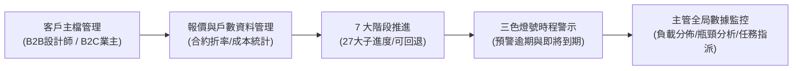

# 正道工業系統櫃事業部｜業務報價與案件時程追蹤系統
## 平台介紹與管理效益報告書（呈閱總公司決策主管）

---

### 報告摘要 (Executive Summary)

為落實正道工業數位轉型策略、提升系統櫃事業部之前端業務效率與案場推進準確度，本事業部正式構建並上線**「業務報價與案件時程追蹤系統」**。

本平台以**「報價精準化、時程透明化、管理數據化、異常主動化」**為核心目標，徹底消除傳統系統櫃產銷過程中依賴人工手寫估算、Excel 離線記錄、案件卡關無法即時發現等營運痛點。透過現代化雲端 Web 架構，讓一線業務、助理及各級主管能在同一資訊基準上協同作業，建立從客戶洽談、現勘丈量、簽約設計、生產發包至完工驗收的全生命週期數位閉環。

---

### 一、 傳統作業瓶頸與開發背景 (Pain Points & Background)

在導入本系統前，系統櫃事業部前端業務面臨以下關鍵營運挑戰：

| 痛點構面 | 傳統作業方式之困境 | 對營運與客戶體驗之負面影響 |
| :--- | :--- | :--- |
| **報價估算** | 業務各自維護 Excel 公式，計價規則（板材、五金、加工、折率）不統一。 | 報價耗時冗長，容易漏算五金配件或算錯折率，侵蝕毛利。 |
| **案件進度** | 案場推進仰賴業務個人記事或口頭回報，處於「資訊黑箱」。 | 總部與主管無法即時掌握全台案場進行到哪一階段，缺乏全局視野。 |
| **異常預警** | 等到客戶投訴或交期迫近時，才發現圖面未確認或生產延宕。 | 處置被動，常導致趕工成本增加、延誤罰款及客戶滿意度下滑。 |
| **業務交接** | 案件細節散落於通訊軟體群組或個人紙本，人員異動時斷層嚴重。 | 歷史進度與報價版本難以追溯，新接手人員耗費大量摸索成本。 |

---

### 二、 系統核心定位與架構理念 (Core Positioning)

本平台定位為**「系統櫃事業部的前端數位化神經中樞」**，串聯客戶關係（CRM）、報價引擎（CPQ）與專案推進（PM），具備四大設計原則：

1. **統一標準，落實內控**：全模組統一計價參數、制式工序與權限分級，避免人為恣意更動。
2. **即時穿透，拒絕黑箱**：案場所有階段推進、回退、修改皆有數位足跡與時間戳記。
3. **主動警示，防患未然**：以動態計算的「綠/黃/紅」三色時程燈號，主動提醒即將到期與逾期案件。
4. **雲端協同，跨端可用**：免安裝軟體，主管與業務無論在辦公室、展間或案場，皆能以手機、平板、電腦即時查閱與回報。

---

### 三、 平台核心功能與管理價值 (Key Capabilities)

#### 1. 整合型案場報價與折率控管
- **標準化登記**：直接登記外部算價定稿之報價總額（`NT$`）與成本預估，自動關聯施作戶數。
- **B2B / B2C 差別折率控管**：自動依照客戶類型（設計師長期簽約折率、建設公司專案折率、一般終端零售）帶入約定折數，保障事業部合理利潤率。
- **歷次填報記錄**：支援歷次報價金額追蹤與里程碑備註留存，便於合約審閱比對。

#### 2. 7 大標準階段與 27 個子進度全景追蹤
- **7 大標準生命週期階段**：
  1. **案件開發**：客源開發、案件分配。
  2. **現況及需求確認**：需求訪談、設計建議、圖面索取、丈量、場勘。
  3. **設計提案／報價／簽約**：設計圖、報價單、提案簡報、合約、送約／簽約。
  4. **生產前確認／拆單**：復丈、二次場勘、施工圖、拆單並提交生產。
  5. **生產及派送**：生產、出貨、派工。
  6. **安裝及驗收**：安裝、監工及現場處置、工程驗收、提交成果驗收、加減帳。
  7. **結案／售後**：批價、請款、結案、追蹤二次回購。
- **正向防呆推進與容錯回退機制**：
  - 各階段設定標準完工目標日，完成後按下一鍵**「完成並推進」**，自動流轉至次一里程碑。
  - 業界首創**「子進度回退上一步」**容錯機制，面對業主臨時變更設計或勘查複驗需求，可安全退回前一步重新修正，確保記錄真實完整。

#### 3. 動態時程警示燈號（Traffic Light System）
系統每日自動比對目前進度、預定完工日與事業部設定之標準工期：
- 🟢 **正常（綠燈）**：進度穩定在預定目標內推進。
- 🟡 **即將到期（黃燈）**：距目標完成日剩餘不足 3 天，提醒業務優先跟進。
- 🔴 **逾期警報（紅燈）**：已超過預定完成日，系統標註逾期天數並自動提報主管監控台。

#### 4. 主管全局戰情室（Manager Dashboard）
- **高階 KPI 儀表板**：進行中總案場數、已簽約預估總額、成交轉化率、逾期案件數等核心指標即時滾動。
- **人員案場負載與異常分佈（Bullet Bar 嵌入圖）**：
  - 採用先進的巢狀雙軸圖表：**外層寬藍柱代表各業務負責總案場數，內層細紅柱代表其名下延誤案場數**。
  - 主管一眼即可洞悉各同仁的案量負荷狀況，以及延誤案場佔個人案量的比例，便於即時進行人工作業調度。
- **階段卡關瓶頸分析**：統計所有案件目前卡在初洽、丈量、報價、下單或完工之分佈，精準揪出部門組織協作瓶頸。
- **主管直接指派任務**：針對卡關案場，主管可由監控台直接開立任務交辦指定人員，獨立追蹤完成情形。

#### 5. 企業級安全與個人化體驗
- **身分權限劃分（RBAC）**：嚴格區分「系統管理員」、「理級主管」、「業務主管」、「業務專員」、「業務助理」之存取頁面與功能。
- **專屬密碼登入機制**：正式啟用個人獨立密碼儲存與驗證體系，支援同仁於個人帳號中心自主變更密碼。
- **沉浸式風格切換**：內建經典藍、翡翠綠、暖木褐、極簡石板灰及夜間深色模式，符合現代企業人機介面規範。

---

### 四、 預期管理效益與 ROI 評估 (Business Impact & ROI)

| 評估指標 | 導入前（傳統人工） | 導入後（數位平台） | 具體效益提升 |
| :--- | :--- | :--- | :--- |
| **報價產出時間** | 平均 2 ~ 3 個工作天 | **縮短至 30 ~ 60 分鐘** | ⚡ **效率提升逾 70%**，大幅增加搶單勝率 |
| **報價失誤率** | 約 5% ~ 8%（漏算加工/折率出錯） | **降至 0.5% 以下** | 💰 守護專案淨毛利，杜絕合約虧損 |
| **案件時程掌控度** | 依賴週會報告，資訊滯後 3~7 天 | **即時動態 100% 透明** | ⏱️ 主管隨時掌握即時現況，溝通零時差 |
| **異常應變反應期** | 延遲發生後 3~5 天方獲知 | **提前 3 天黃燈預警** | 🛡️ 大幅降低延遲交期客訴與違約風險 |
| **業務人員交接成本** | 需 2 週以上口頭梳理案場資料 | **1 小時內完整調閱歷史脈絡** | 👥 人員輪調或請假代理無縫銜接 |

---

### 五、 技術架構與可靠度 (System Reliability & Security)

- **前端技術**：採用現代化 **Next.js 14（App Router）** 與 React 18，結合 TailwindCSS 與高效快取技術（TanStack React Query），提供秒級反應的流暢體驗。
- **後端與資料庫**：採用 **Prisma ORM** 配合雲端關聯式資料庫 **PostgreSQL (Supabase)**，支援完整事務交易（Transactions）與關聯完整性，確保財務與案場資料安全無虞。
- **高可用部署**：部署於國際級頂級雲端平台 **Vercel**，享有全球 CDN 邊緣加速、自動備份與高防護防火牆，系統妥善率（SLA）達 99.9% 以上。

---

### 六、 未來演進藍圖 (Future Roadmap)

1. **第一階段（現已完成並正式上線）**：
   - 完備前端客戶主檔、案件報價登記、7 大標準階段追蹤、主管監控室與個人化密碼管理。
2. **第二階段（規劃中）**：
   - 整合 ERP/生管系統接口，自動將已下單案場同步至工廠生產排程軟體與板材庫存水位。
3. **第三階段（願景展望）**：
   - 導入 AI 輔助圖面空間估價、客戶喜好智慧推薦與案場竣工拍照驗收上傳系統。

---

> **結語**  
> 「業務報價與案件時程追蹤系統」的上線，標誌著正道工業系統櫃事業部在前端銷售與專案執行上邁入全新里程碑。期望透過本平台的數位賦能，全面提升同仁產能與管理能見度，為總公司創造更高之營收與品牌聲譽。
