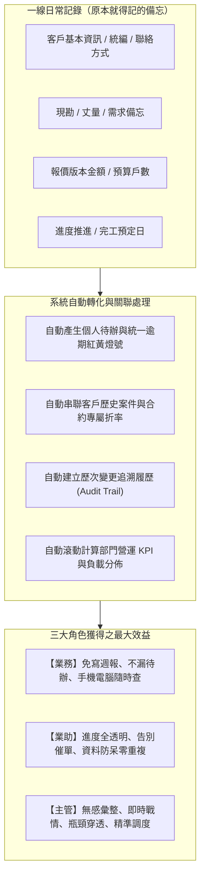

# 正道工業系統櫃事業部｜業務報價與案件時程追蹤系統
# 全角色系統操作手冊與效益指南（業務／業助／主管／管理員）

---

## 目錄 (Table of Contents)

- [導言與系統核心理念](#導言與系統核心理念)
  - [核心設計原則：一次登打、自動沉澱、效益最大化](#核心設計原則一次登打自動沉澱效益最大化)
  - [資訊流轉與效益架構圖](#資訊流轉與效益架構圖)
  - [系統環境與支援裝置建議](#系統環境與支援裝置建議)
- [第一篇：三大使用者角度之核心優勢與效益剖析](#第一篇三大使用者角度之核心優勢與效益剖析)
  - [1.1 傳統作業 vs. 平台化效益對比總表](#11-傳統作業-vs-平台化效益對比總表)
  - [1.2 業務專員角度：隨手記錄即待辦，告別手寫週報](#12-業務專員角度隨手記錄即待辦告別手寫週報)
  - [1.3 業務助理角度：進度完全透明，告別催單與重複建檔](#13-業務助理角度進度完全透明告別催單與重複建檔)
  - [1.4 單位主管角度：無感彙整零時差，全局透視與科學調度](#14-單位主管角度無感彙整零時差全局透視與科學調度)
- [第二篇：共用基礎操作與帳號安全](#第二篇共用基礎操作與帳號安全)
  - [2.1 系統登入與初次登入須知](#21-系統登入與初次登入須知)
  - [2.2 修改個人登入密碼（重要安全指引）](#22-修改個人登入密碼重要安全指引)
  - [2.3 介面風格與閱讀密度切換](#23-介面風格與閱讀密度切換)
  - [2.4 安全登出](#24-安全登出)
- [第三篇：業務專員操作指引 (Sales Rep Guide)](#第三篇業務專員操作指引-sales-rep-guide)
  - [3.1 每日工作起點：業務工作台 (Sales Workbench)](#31-每日工作起點業務工作台-sales-workbench)
  - [3.2 案件清單多條件篩選、關鍵字搜尋與雙向排序](#32-案件清單多條件篩選關鍵字搜尋與雙向排序)
  - [3.3 快速新增案場與行內展開編輯 (Inline Collapsible Edit)](#33-快速新增案場與行內展開編輯-inline-collapsible-edit)
  - [3.4 案件里程碑與 7 大標準階段推進（共 27 個子進度）](#34-案件里程碑與-7-大標準階段推進共-27-個子進度)
  - [3.5 歷次執行紀錄追加（丈量／場勘／報價多筆紀錄 `[+]`）](#35-歷次執行紀錄追加丈量場勘報價多筆紀錄-)
  - [3.6 里程碑容錯機制：子進度「回退上一步 (Rollback)」操作指南](#36-里程碑容錯機制子進度回退上一步-rollback-操作指南)
  - [3.7 案場報價、成本與戶數資料維護](#37-案場報價成本與戶數資料維護)
- [第四篇：業務助理協同指引 (Assistant Guide)](#第四篇業務助理協同指引-assistant-guide)
  - [4.1 跨專案進度即時協同查閱](#41-跨專案進度即時協同查閱)
  - [4.2 多元可視化視圖 (`/views`)：甘特圖與外勤行事曆](#42-多元可視化視圖-views甘特圖與外勤行事曆)
  - [4.3 客戶主檔建檔、即時防呆與折率管理 (`/customers`)](#43-客戶主檔建檔即時防呆與折率管理-customers)
  - [4.4 關鍵審核節點跟催與工廠發包派工銜接](#44-關鍵審核節點跟催與工廠發包派工銜接)
- [第五篇：單位主管操作指引 (Manager Guide)](#第五篇單位主管操作指引-manager-guide)
  - [5.1 主管監控室 4 大核心營運 KPI 深度解讀 (`/dashboard/manager`)](#51-主管監控室-4-大核心營運-kpi-深度解讀-dashboardmanager)
  - [5.2 人員案場負載與異常分佈圖（Bullet Bar 巢狀柱狀圖深度判讀）](#52-人員案場負載與異常分佈圖bullet-bar-巢狀柱狀圖深度判讀)
  - [5.3 7 大主要階段卡關瓶頸穿透分析](#53-7-大主要階段卡關瓶頸穿透分析)
  - [5.4 主管重要任務交辦 (Assigned Tasks) 與獨立列管](#54-主管重要任務交辦-assigned-tasks-與獨立列管)
  - [5.5 客戶維度營運分析看板 (`/dashboard/manager/customers`)](#55-客戶維度營運分析看板-dashboardmanagercustomers)
- [第六篇：系統管理員設定指引 (Admin Guide)](#第六篇系統管理員設定指引-admin-guide)
  - [6.1 使用者帳號維護與角色頁面授權矩陣](#61-使用者帳號維護與角色頁面授權矩陣)
  - [6.2 強制重設同仁登入密碼](#62-強制重設同仁登入密碼)
  - [6.3 全域案件清單欄位自訂與標準工期參數配置](#63-全域案件清單欄位自訂與標準工期參數配置)
- [第七篇：系統櫃 7 大標準階段與 27 個子進度速查表](#第七篇系統櫃-7-大標準階段與-27-個子進度速查表)
- [第八篇：實務作業情境 SOP 示範 (Scenario Walkthrough)](#第八篇實務作業情境-sop-示範-scenario-walkthrough)
  - [情境一：業務跑外勤現場丈量與需求訪談](#情境一業務跑外勤現場丈量與需求訪談)
  - [情境二：業主臨時修改報價規格（退回重報與歷次紀錄）](#情境二業主臨時修改報價規格退回重報與歷次紀錄)
  - [情境三：主管週會戰情檢視與人員協同調度](#情境三主管週會戰情檢視與人員協同調度)

---

## 導言與系統核心理念

本系統為正道工業系統櫃事業部量身打造之雲端現代化作業平台，主要服務於一線業務專員、業務助理、單位主管與系統管理員。

### 核心設計原則：一次登打、自動沉澱、效益最大化

在傳統系統櫃接案與工程服務流程中，資訊往往高度碎片化——業務將案場現況記在隨身紙本、尺寸存在手機備忘錄、圖面與報價散落在 LINE 記事本與個人電腦 Excel 中。這種傳統模式不僅耗時費力，更衍生出「業務忙於回報、業助忙於催單、主管忙於追問」的三角內耗。

本系統的核心設計理念即是：**「一次登打、自動沉澱、效益最大化」**。
將同仁**原本就必須記錄在紙本或手機裡的案場備忘資訊**，直接登記於本平台，系統即會**自動轉化為個人待辦事項、案場歷程軌跡、時程預警燈號，並即時滾動彙整為全事業部的營運統計數據與戰情看板**。

### 資訊流轉與效益架構圖



### 系統環境與支援裝置建議

本系統採用純 Web 現代化自適應架構，免安裝任何軟體，透過瀏覽器即可安全登入：
- **建議瀏覽器**：Google Chrome、Microsoft Edge、Safari 等最新穩定版本。
- **支援硬體裝置**：桌上型電腦、筆記型電腦、iPad / Android 平板電腦以及各型號智慧型手機均可自適應流暢瀏覽與操作。

---

## 第一篇：三大使用者角度之核心優勢與效益剖析

### 1.1 傳統作業 vs. 平台化效益對比總表

| 評估構面 | 業務專員 (Sales) | 業務助理 (Assistant) | 單位主管 (Manager) |
| :--- | :--- | :--- | :--- |
| **核心優勢一句話** | **隨手記錄即待辦，從此告別手寫週報** | **跨案進度全透明，告別追問與重複建檔** | **無感彙整零時差，全局透視與科學調度** |
| **原本傳統作業困境** | 現場筆記寫在紙上或手機，回公司還得重打進 Excel；案件一多容易忘記跟進；每週花 1~2 小時整理週報。 | 隨時要打電話問業務「圖畫好了沒？」、「合約簽了沒？」；客戶統編與折數常因口頭交代而出錯。 | 依賴口頭或每週例會報告，掌握的資訊往往滯後數天；案件卡關或客訴發生時才知逾期；無法精準掌握人員真實負荷。 |
| **平台轉化後效益** | 點選手機/平板完成記錄，系統自動列入待辦清單並亮燈提醒；主管已在系統看到，無需額外匯報。 | 開啟系統即可掌握全台所有案場即時進度；客戶統編電話自動防呆查重；審核進度清清楚楚。 | 業務日常作業同時自動生成 4 大營運 KPI、Bullet Bar 人員負載圖與 7 大階段卡關瓶頸分析，決策快又準。 |

---

### 1.2 業務專員角度：隨手記錄即待辦，告別手寫週報

1. **隨手登記即形成備忘與待辦，告別健忘**：
   - 業務在外跑工地、見設計師時，只要用手機或平板在案場子進度（如「丈量」、「需求訪談」）中輸入預定日期與備忘筆記，系統**自動將其同步至個人工作台的待辦事項清單**。
   - 接近到期日自動亮黃燈、過期亮紅燈，業務每天開機只看「今日待辦」，再也不怕遺漏對客戶的承諾。
2. **多版本與歷次紀錄完整保留，現場應變有依據**：
   - 系統櫃常遇「二次丈量」、「改圖第三版」、「三次追加報價」。過去散落各處難以考證，現在系統支援在同一節點點擊 `[+]` 新增多次紀錄，詳實記錄時間、金額、備忘與負責人，責任釐清無爭議。
3. **免寫例行週報，省下時間全力衝業績**：
   - 主管在「主管監控室」隨時看到最新案場動態與推進時間戳記。業務不需要再花週五下午的時間填寫文字週報或簡報，把時間留給客戶開發與成交。
4. **貼心回退上一步（Rollback）容錯設計**：
   - 業主臨時改規格、或丈量發現結構有疑義時，提供「回退上一步」功能，無需求助資訊人員重設，操作靈活符合真實業務場景。

---

### 1.3 業務助理角度：進度完全透明，告別催單與重複建檔

1. **跨業務案場進度完全透明，消除溝通斷層**：
   - 過去業助追蹤進度必須逐一詢問業務：「XX案場報價單發了沒？」、「工廠施工圖畫好了沒？」。現在進入工作台或多元可視化視圖（甘特圖／行事曆），全體同仁案場進度一目了然。
2. **客戶主檔建立即時防呆，杜絕統編電話重複**：
   - 系統在建立客戶時內建即時檢核：當輸入已存在之「統一編號」或「聯絡電話」時，系統即時提示衝突客戶名稱，避免同一個設計師或廠商被不同同仁重複建檔。
3. **客戶折率與交易條件自動帶入**：
   - 業助維護好 B2B 客戶（設計師、建設公司）的合約折率後，業務建立該客戶案場時系統自動鎖定帶入，杜絕報價算錯折率侵蝕毛利的風險。
4. **精準把握審核與發包時間點**：
   - 掌握「設計圖、報價單、提案簡報、合約、施工圖」需審核項目的提交狀態，審核通過後即刻協助排定出貨與派工，銜接工廠生產零延誤。

---

### 1.4 單位主管角度：無感彙整零時差，全局透視與科學調度

1. **零成本數據彙整，實現「無感管理」**：
   - 主管無需三催四請叫大家交報表。因為業務在為自己做工作備忘的同時，已將即時數據「無感」注入資料庫，主管隨時打開螢幕就是最新戰情。
2. **即時核心 KPI 自動滾動**：
   - **進行中總案場數**：事業部當前戰力水位（預設排除流標與已立帳專案）。
   - **已簽約預估總額**：已完成「3-5 送約/簽約」之確定營收池。
   - **成交率**：精準掌握從客源開發到落袋為安的漏斗轉化。
   - **逾期案件數**：全系統統一由時程引擎即時判定，不留盲區。
3. **獨家 Bullet Bar（巢狀柱狀圖）看穿人員負荷與能力**：
   - 透過「外層寬柱（案場總量）」與「內層細紅柱（逾期延誤量）」的對比，一眼識破誰是「案多效率高的王牌業務」，誰是「案少卻頻頻卡關需輔導的同仁」，資源分配極其科學。
4. **7 大主要階段瓶頸穿透分析**：
   - 清楚透視案件究竟卡在前端「需求確認」、中端「設計提案與報價」、還是後端「工廠生產與安裝驗收」，精準對組織流程動刀改善。
5. **主管交辦任務獨立列管**：
   - 針對異常案場可直接在平台指派專屬任務給特定同仁，獨立追蹤，處理完成前絕不漏接。

---

## 第二篇：共用基礎操作與帳號安全

### 2.1 系統登入與初次登入須知

1. 開啟系統網址後，若尚未登入，將自動跳轉至系統登入頁。
2. 在「**使用者**」下拉選單中選取您的姓名。
3. 在「**密碼**」欄位中輸入密碼：
   - **系統預設密碼**：全體使用者初始預設密碼統一為 `0000`。
   - **自訂密碼**：若您已於系統中變更過密碼，請輸入您的專屬新密碼。
4. 點擊「**登入系統**」按鈕即可進入對應角色之主頁面。

---

### 2.2 修改個人登入密碼（重要安全指引）

> [!IMPORTANT]
> 為確保客戶商業隱私、成本利潤與報價資料安全，強烈建議全體同仁於首次登入後立即修改個人專屬密碼。

1. 點擊頂部導航列右上角個人名稱右側的「**齒輪圖示（個人設定）**」進入帳號管理頁面。
2. 在「**更改登入密碼**」區塊依序填入：
   - **目前密碼**：輸入舊密碼（初次使用者請輸入預設 `0000`）。
   - **新密碼**：輸入至少 4 碼以上的新密碼。
   - **確認新密碼**：再次輸入新密碼以防止輸入錯誤。
3. 點擊「**確認更新密碼**」。
4. 看到綠色提示「密碼已成功更新！下次登入即生效。」即代表完成變更。下次登入時必須使用新密碼。

---

### 2.3 介面風格與閱讀密度切換

系統提供五大現代化主題配色與排版密度切換，設定將自動記憶在您的瀏覽器中：
1. 進入「**個人設定**」頁面。
2. **主題配色**：
   - 🔵 **經典商務藍 (Blue)**：預設風格，清新穩健。
   - 🟢 **翡翠森林綠 (Emerald)**：深綠頂欄與漸層按鈕，專注護眼。
   - 🟠 **溫潤暖木褐 (Amber)**：木質調風格，貼合系統櫃居家意象。
   - ⚪ **專業極簡灰 (Slate)**：沉穩低調的高級灰階。
   - 🌙 **夜間深色模式 (Dark)**：深灰底色與高對比文字，夜間工作不易疲勞。
3. **介面密度**：
   - **舒適標準排版**：間距寬鬆，適合觸控或長時間閱讀。
   - **緊湊高容量排版**：縮減欄位間距，適合大螢幕一頁檢視多筆案場資料。
4. 點擊「**套用並儲存設定**」即刻生效。

---

### 2.4 安全登出

- 點擊頂部導航列最右側的「**登出（帶箭頭的退出圖示）**」按鈕，系統將清除暫存 Session 並安全返回登入頁面。

---

## 第三篇：業務專員操作指引 (Sales Rep Guide)

### 3.1 每日工作起點：業務工作台 (Sales Workbench)

點擊頂部「**業務工作台**」，此頁面是業務專員日常作業的核心中樞：
- **頂部統計卡片**：顯示個人負責的進行中案件數、本月預定完工數、逾期案場數等關鍵指標。
- **我的待辦事項 (My Tasks)**：
  - 畫面頂端整合列出指派給個人的所有里程碑與交辦任務。
  - **紅底紅字「已逾期」標籤**：代表已超過預定完成日，提醒優先跟進處理。
  - **完成待辦**：點擊綠色勾選按鈕，在彈出視窗輸入實際完成日期與執行備忘，點擊「確認完成」，系統自動記錄時間戳記並推進下一項目。
- **快捷動作**：包含一鍵建立新案件、切換排序與複合條件篩選。

---

### 3.2 案件清單多條件篩選、關鍵字搜尋與雙向排序

在案件清單上方工具列，可運用複合條件快速過濾案場：
1. **起訖月份區間查詢**：在「月份：[ 年-月 ] 至 [ 年-月 ]」選單中挑選起始與結束月份（如 `2026-01` 至 `2026-12`）；點擊「清除」按鈕即可重置查看全期間。
2. **案件狀態燈號篩選**：
   - 🔴 **逾期（紅燈）**：已超過預定完工日或工期逾期，需優先排除。
   - 🟡 **即將到期（黃燈）**：距預定完成日不足 3 天，提醒加速收尾。
   - 🟢 **正常（綠燈）**：時程平穩進行中。
   - **未排定**：尚未設定完工目標日之早期階段案件。
   - **已流標**：未成交結案案件（預設清單已自動排除）。
3. **關鍵字即時搜尋**：輸入案名、業主姓名或電話，清單將即時過濾符合結果。
4. **雙向排序功能**：點擊「**預定完工日**」或「**狀態燈號**」欄位標題，可於升冪、降冪與預設排序間即時切換。

---

### 3.3 快速新增案場與行內展開編輯 (Inline Collapsible Edit)

1. **快速新增案場**：
   - 點擊工具列「**＋ 建立新案件**」按鈕。
   - 依序填入：案場名稱、挑選客戶、工址地址、施作戶數、預定完工日與現況說明，點擊儲存即刻開案。
2. **行內展開編輯 (Inline Collapsible Edit)**：
   - 在案件清單中點擊該列右側的「**編輯（鉛筆圖示）**」。
   - 編輯表單將**直接於該行下方流暢展開**，無需跳轉整頁。
   - 採用獨立隔離渲染架構（[`WorkbenchProjectForms`](file:///D:/RW_CabSalesProject/src/components/workbench/WorkbenchProjectForms.tsx)），在輸入大量現場備忘文字或微調預估金額時反應極速，儲存後即刻同步更新。

---

### 3.4 案件里程碑與 7 大標準階段推進（共 27 個子進度）

進入任一案場的「**里程碑追蹤**」頁面（`/projects/[id]/milestones`）：
1. **階段標籤切換**：頂部標籤頁由左至右包含系統櫃完整生命週期之 7 大標準階段（案件開發 ➔ 現況及需求確認 ➔ 設計提案/報價/簽約 ➔ 生產前確認/拆單 ➔ 生產及派送 ➔ 安裝及驗收 ➔ 結案/售後）與額外階段（收尾、已流標）。
2. **當前進行中進度**：畫面中進行中的子進度會以藍色邊框與「進行中」醒目標籤標示。
3. **完成並推進**：
   - 點擊「**完成並推進**」，彈出完成確認視窗。
   - 填寫「實際完成日」與「執行備忘」（如：「現場樑下實測 238cm，業主確認鞋櫃改懸空式」）。
   - 點擊送出後，系統自動將完成時間戳記固化，並自動啟動下一個順位子進度。
4. **標準工序自動流轉**：系統嚴格遵循 7 大階段 27 個標準工序規範流轉，降低人為錯漏。

---

### 3.5 歷次執行紀錄追加（丈量／場勘／報價多筆紀錄 `[+]`）

實務作業中，丈量、場勘與報價往往經歷多次來回。系統支援在同一進度節點追加多次紀錄：
1. 在支援歷次紀錄的子進度卡片上（如 `2-4 丈量`、`2-5 場勘`、`3-2 報價單`、`6-5 加減帳`），點擊「**[+] 歷次紀錄**」。
2. 填入：
   - **日期**：預定或實際執行日期。
   - **金額（報價節點專用）**：填報本次報價版本之總額（萬元）。
   - **負責人員**：指派特定外勤同仁或製圖人員。
   - **執行備忘**：詳述變更細節（如：「第 2 次複丈：廚房插座位置已移位，符合電器櫃圖面」）。
3. 點擊「**儲存紀錄**」，所有歷次演進歷程依序展開陳列，有據可查。

---

### 3.6 里程碑容錯機制：子進度「回退上一步 (Rollback)」操作指南

> [!TIP]
> 實務作業中，常遇業主臨時要求變更報價規格、或現場現勘複尺不符需退回重測。本系統提供安全的進度回退機制。

#### 操作步驟：
1. 進入該案件的「里程碑追蹤」頁面。
2. 系統在兩個位置貼心提供回退操作按鈕：
   - **在「最後一個已完成」的子進度卡片上**：點擊「**回退此進度**」按鈕。
   - **在「當前進行中」的子進度卡片上**：點擊「**回退上一步**」按鈕。
3. 彈出確認視窗：「確定要將此進度退回到上一個項目嗎？完成時間將被重設。」
4. 點擊「**確定回退**」，系統將清除完成記錄並將進行中狀態移回上一個項目。
5. **權限限制**：僅**負責該案場之業務專員**與**單位主管**具備回退權限。

---

### 3.7 案場報價、成本與戶數資料維護

在案件清單或案件詳細頁面中維護案場報價與相關數值：
1. **報價與成本登記**：直接登記外部算價定稿之報價總額（`NT$`）與成本預估，系統自動帶入客戶約定折率並顯示於「報價 / 戶數」欄位。
2. **戶數與預算統計**：維護案件施作戶數與預估預算，系統將於主管監控室即時滾動計算全廠簽約預估總額與各客戶合作產值。
3. **歷次報價紀錄**：可於里程碑「3-2 報價單」及「6-5 加減帳」追加填報歷次報價金額、負責業務與執行歷程備註。

---

## 第四篇：業務助理協同指引 (Assistant Guide)

### 4.1 跨專案進度即時協同查閱

- **全域案件穿透檢視**：業務助理可透過「業務工作台」案件清單，查閱全公司或指定業務同仁名下的全部案場。
- **關注關鍵節點**：檢視「階段 / 進度」欄位，立即獲知特定專案究竟是停留在「3-2 報價單」等待審核，還是已推進到「4-4 拆單並提交生產」，省去頻繁傳訊打電話問詢的時間。

---

### 4.2 多元可視化視圖 (`/views`)：甘特圖與外勤行事曆

點擊頂部導覽列「**多元可視化**」，系統提供直觀的可視化時程圖表：
1. **甘特圖 (Gantt Chart)**：
   - 橫軸為專案推進時間軸，縱軸依序陳列各專案名稱與進行中里程碑。
   - 清楚掌握各案場完工預定日的先後順序、重疊高峰期與交期緩急。
2. **外勤行事曆 (Calendar View)**：
   - 以月曆或週曆方式呈現外勤同仁現場丈量（`2-4`）、場勘（`2-5`）、安裝（`6-1`）與驗收（`6-4`）排程。
   - 輔助助理協調師傅出工與物流派車時程。

---

### 4.3 客戶主檔建檔、即時防呆與折率管理 (`/customers`)

點擊頂部「**客戶主檔**」，本模組集中維護事業部所有長期合作夥伴名冊：
1. **新增與維護客戶**：點擊右上角「**＋ 新增客戶**」，輸入客戶名稱、電話、地址與統一編號。
2. **即時防呆重複檢驗機制**：
   - 系統在輸入統一編號或電話時自動比對資料庫。
   - 若該統編或電話已被建檔，系統會立即顯示紅字警告：「統一編號重複：已存在相同統編之客戶『品辰室內設計』」，防止重複建檔造成歷史資料分散。
3. **客戶類型與合約折率管理**：
   - **B2B 客戶**（設計師、建設公司、統包商）：設定長期簽約折率（如 `0.85` 代表 85 折，`0.70` 代表 7 折）。
   - **B2C 客戶**（一般終端業主）：預設折率通常為 `1.00`（不打折）或門市專案折數。
   - 未來業務在為該客戶建立新案場時，系統會自動鎖定帶入此預設折率，省去重複計算與手動改價手續。

---

### 4.4 關鍵審核節點跟催與工廠發包派工銜接

- **5 大需審核項目即時掌握**：
  - 系統內建需審核節點包含：`3-1 設計圖`、`3-2 報價單`、`3-3 提案簡報`、`3-4 合約擬定`、`4-3 施工圖`。
- **發包與派工協同流程**：
  - 業助檢視業務是否已點擊「提交審核」；當主管審核通過後，等待審核標籤自動解除。
  - 業助接棒跟進後續發包：確認工廠板材五金備料進度（`5-1 生產`），並協助排定物流出貨（`5-2 出貨`）與工班組裝師傅（`5-3 派工`），確保前後端無縫咬合。

---

## 第五篇：單位主管操作指引 (Manager Guide)

點擊頂部導航列「**主管監控室**」（`/dashboard/manager`），本模組為事業部主管專用之營運戰情看板。

### 5.1 主管監控室 4 大核心營運 KPI 深度解讀

頂部提供四大即時滾動之核心經營指標：
1. **進行中總案場數**：
   - 目前全體業務手中推進中的案場總量（預設系統已自動排除已流標 `LOST` 與已立帳 `BILLED` 之案件，真實反映在製水位）。
2. **已簽約/生產預估總額**：
   - 嚴格統計里程碑已完成「`3-5 送約/簽約`」之後的案場總報價預算。為確定入袋或工廠生產中的真實營業金額池，避免將早期未定案案件灌水計入。
3. **成交率 (%)**：
   - 已簽約案場佔全部開案案場之百分比，精準衡量前端線索之簽約轉化效率。
4. **逾期案件數（紅底粗體標註）**：
   - 全系統（主管監控室、業務工作台、甘特圖／行事曆視圖）一律由核心時程引擎（[`ScheduleEngine.isProjectDelayed`](file:///D:/RW_CabSalesProject/src/lib/schedule-engine.ts)）為單一真理來源計算，精準掌握真實逾期專案數，點擊可快速過濾出問題專案。

---

### 5.2 人員案場負載與異常分佈圖（Bullet Bar 巢狀柱狀圖深度判讀）

主管監控室左側圖表採用高階 **Bullet Bar 嵌入式巢狀柱狀圖**：

```
各業務人員柱狀圖範例：
┌───────────────────────────────┐
│     外層寬藍柱（總案場數）      │
│   ┌───────────────────────┐   │
│   │ 內層細紅柱 (逾期案件) │   │
└───┴───────────────────────┴───┘
```

- **外層寬藍柱**：代表該業務同仁目前承接的「案場總數」（柱體愈高代表名下案件負載愈重）。
- **內層細紅柱**：代表該同仁名下出現「時程延誤」的案場數量（直接置中嵌入在藍柱之中）。
- **管理判讀重點**：
  - **健康產能型**：外層藍柱極高但內層紅柱極短甚至為零 ➔ 代表業務接單產能飽滿且專案時程控管極佳，可予以表揚或指派重要指標大案。
  - **卡關需輔導型**：外層藍柱適中但內層紅柱佔比超過 40% ➔ 代表該業務在推進上遭遇障礙（如圖面頻繁修改、工班銜接問題或個人負荷過重），主管應立即介入協調資源。
  - **負載失衡型**：某同仁外柱遠高於其他同仁 ➔ 主管應於「案件分配」階段重新平衡團隊案量。

---

### 5.3 7 大主要階段卡關瓶頸穿透分析

主管監控室右側橫向條形圖分析：
- 橫條顯示目前所有進行中案件停留在 7 大標準階段（案件開發、現況及需求確認、設計提案/報價/簽約、生產前確認/拆單、生產及派送、安裝及驗收、結案/售後）的數量分佈。
- **三色警報機制**：
  - ⚪ **灰色**：該階段案件流轉順暢，無嚴重延遲。
  - 🟡 **黃色**：該階段出現 1~2 件逾期案件，需持續留意。
  - 🔴 **紅色**：該階段累積超過 2 件以上逾期案件，警示流程存在結構性瓶頸（例如：拆單繪圖人手短缺、工廠排程塞車），主管應立即召集跨部門會議排除阻礙。

---

### 5.4 主管重要任務交辦 (Assigned Tasks) 與獨立列管

針對異常或需要專案跟進的案場，主管可直接在系統中下達任務交辦：
1. **直接交辦任務**：
   - 在主管監控室「案件清單」中，點擊該專案旁的「**指派任務**」。
   - 採用獨立隔離渲染彈窗（[`ManagerAssignTaskModal`](file:///D:/RW_CabSalesProject/src/components/dashboard/ManagerAssignTaskModal.tsx)），填寫：指派對象、任務主旨（如：「請於本週三前確認現場追加封邊尺寸」）、截止日期與優先度（高/中/低）。
2. **獨立列管與雙向連動**：
   - 推進里程碑產生的日常待辦不會雜亂混入主管任務清單。本清單僅保留主管親自交辦的重要任務。
   - 任務會直接同步出現在該同仁的「業務工作台」待辦清單中；在同仁回報完成前，主管看板維持獨立追蹤。
3. **任務移除與歸檔**：主管確認已達成或情況變更時，可一鍵點擊「**刪除**」按鈕將其自清單中移除。

---

### 5.5 客戶維度營運分析看板 (`/dashboard/manager/customers`)

點擊主管監控室右上角的「**客戶統計分析**」進入獨立分析頁面：
1. **客戶營運產值全覽**：彙整各客戶合作之總案場數、進行中數、總簽約金額、總報價金額與預設折數。
2. **多維度交叉過濾與排序**：
   - 支援依「客戶類型」（設計公司、建設營造、工廠等）與「負責業務」快速過濾。
   - 支援搜尋關鍵字（客戶名稱、統一編號、電話）。
   - 點擊「**合作案場數**」或「**已簽約金額**」欄位標題即時排序，精準鎖定全廠前 20% 的頂級 VIP 合作夥伴。

---

## 第六篇：系統管理員設定指引 (Admin Guide)

點擊頂部導航列「**管理者設定**」（僅具備 `ADMIN` 權限者可見）。

### 6.1 使用者帳號維護與角色頁面授權矩陣

1. **帳號清單檢視**：可查看全體同仁之帳號姓名、電子郵件、目前角色（系統管理員、理級主管、業務主管、業務助理、業務專員）。
2. **角色頁面授權矩陣**：
   - 可依公司組織架構，自訂各角色能夠存取的系統頁面（如業務專員可否查看主管監控台等），勾選後點擊「**儲存授權設定**」即刻生效。

---

### 6.2 強制重設同仁登入密碼

當同仁遺忘個人密碼時，管理員具備最高重設權限：
1. 在「帳號管理與密碼」表格中，找到該同仁姓名。
2. 點擊其右側的「**🔑 密碼**」按鈕，彈出密碼重設視窗。
3. 輸入新密碼與確認新密碼（至少 4 碼，若欲復原為預設可輸入 `0000`）。
4. 點擊「**儲存新密碼**」。
5. 儲存成功後，該同仁**下次登入時立即採用該新密碼**。

---

### 6.3 全域案件清單欄位自訂與標準工期參數配置

1. **全域案件清單欄位自訂**：
   - 可調整業務工作台與主管看板中案件表格各欄位（狀態燈號、預定完工日、客戶名稱、負責業務等）之顯示/隱藏與排列順序，維持全廠欄位標準一致性。
2. **里程碑標準工期天數配置**：
   - 系統依據 7 大標準階段之子進度（如客源開發 5 天、需求訪談 3 天、設計圖 5 天、生產 12 天、安裝 5 天等）設有預設工期，作為全系統動態紅黃綠燈號判定之依據。管理員可於後台視事業部需求調整預設參數。

---

## 第七篇：系統櫃 7 大標準階段與 27 個子進度速查表

| 階段代碼 | 階段名稱 | 子進度代碼 | 子進度名稱 | 預設工期 | 審核與報價屬性 | 備註說明 |
| :---: | :--- | :---: | :--- | :---: | :---: | :--- |
| **1** | **案件開發** | 1-1 | 客源開發 | 5 天 | 一般 | 接洽潛在終端業主、設計師或統包公司 |
| | | 1-2 | 案件分配 | 2 天 | 一般 | 主管於監控室指派負責業務專員與業務助理 |
| **2** | **現況及需求確認** | 2-1 | 需求訪談 | 3 天 | 一般 | 空間風格、家庭人口、生活習慣與收納配置訪談 |
| | | 2-2 | 設計建議 | 3 天 | 一般 | 初步概念配置提案與板材選用建議 |
| | | 2-3 | 圖面索取 | 2 天 | 一般 | 索取建築圖、室內裝修平面圖或水電配置圖 |
| | | 2-4 | 丈量 | 2 天 | 歷次紀錄 `[+]` | 現場實尺放樣與結構複測（支援多次紀錄填報） |
| | | 2-5 | 場勘 | 2 天 | 歷次紀錄 `[+]` | 搬運動線、電梯尺寸、現場公差與水電現況勘查 |
| **3** | **設計提案／報價／簽約** | 3-1 | 設計圖 | 5 天 | **【需審核】** | 平面配置圖與 3D 效果圖（主管線上審核通過後推進） |
| | | 3-2 | 報價單 | 5 天 | **【需審核】** / 報價 `[+]` | 外部拆單算價金額填報、合約折率套用與主管審核 |
| | | 3-3 | 提案簡報 | 5 天 | **【需審核】** | 向業主正式簡報提案與設計方案評估 |
| | | 3-4 | 合約擬定 | 5 天 | **【需審核】** | 擬定合約條款、施工工期與保固約定條文 |
| | | 3-5 | 送約／簽約 | 2 天 | **KPI 關鍵節點** | 雙方簽署完成（**正式計入主管簽約總額與成交率**） |
| **4** | **生產前確認／拆單** | 4-1 | 復丈 | 2 天 | 一般 | 現場泥作木作完成後二次精準複尺 |
| | | 4-2 | 二次場勘 | 2 天 | 一般 | 確認現場可進場施作條件與現場障礙排除 |
| | | 4-3 | 施工圖 | 5 天 | **【需審核】** | 拆單生產專用之細部施工製造圖審核 |
| | | 4-4 | 拆單並提交生產 | 3 天 | 一般 | 拋轉板材裁切清單與五金配件清冊至工廠生管 |
| **5** | **生產及派送** | 5-1 | 生產 | 12 天 | 一般 | 工廠裁板、封邊、排孔、試組裝與備料包裝 |
| | | 5-2 | 出貨 | 1 天 | 一般 | 物流專車裝載並配送至工址現場 |
| | | 5-3 | 派工 | 2 天 | 一般 | 安排系統櫃組裝師傅與現場監工人員出工 |
| **6** | **安裝及驗收** | 6-1 | 安裝 | 5 天 | 一般 | 櫃體組裝、立板固定、門片調整與五金安裝 |
| | | 6-2 | 監工及現場處置 | 5 天 | 一般 | 現場公差收邊、插座開孔與臨時突發狀況處置 |
| | | 6-3 | 工程驗收 | 2 天 | 一般 | 內部施工品質自主檢驗確認 |
| | | 6-4 | 提交成果驗收 | 2 天 | 一般 | 會同設計師、統包商或終端業主進行正式成果驗收 |
| | | 6-5 | 加減帳 | 5 天 | 報價 `[+]` | 現場追加減項目金額核算與合約修訂填報 |
| **7** | **結案／售後** | 7-1 | 批價 | 3 天 | 報價 `[+]` | 最終成本與毛利核算確認 |
| | | 7-2 | 請款 | 5 天 | 一般 | 開立工程發票並追蹤尾款順利入帳 |
| | | 7-3 | 結案 | 2 天 | 一般 | 專案正式歸檔（移入完成清單） |
| | | 7-4 | 追蹤二次回購 | 30 天 | 一般 | 售後保固關懷、客戶滿意度調查與轉介紹跟進 |
| **X** | **額外階段** | X-1 | 收尾 | 5 天 | 一般 | 驗收後微調補件專用收尾追蹤 |
| | | X-2 | 已流標 | 0 天 | 唯讀防呆 | 未成交歸檔，鎖定為唯讀狀態避免誤動 |

---

## 第八篇：實務作業情境 SOP 示範 (Scenario Walkthrough)

### 情境一：業務跑外勤現場丈量與需求訪談

1. **現場記錄**：業務小陳至南港工地現場丈量，使用手機開啟系統進入「**業務工作台**」，點開該案場之「**進度追蹤**」。
2. **切換進度**：點擊切換至「**第二階段：現況及需求確認**」。
3. **完成並記錄**：
   - 點選「`2-4 丈量`」，點擊「**完成並推進**」。
   - 輸入實際完成日為今日，於備忘欄輸入：「現場樑下高度 240cm，業主確認主臥衣櫃採無把手斜導角門片，玄關鞋櫃懸空 20cm 預留嵌燈開孔」。
   - 點擊「確認完成」。
4. **系統自動轉化效益**：
   - 業務的工作台待辦清單立即劃掉丈量事項，並自動將「`2-5 場勘`」或「`3-1 設計圖`」排入後續待辦。
   - 業助於後台看到最新丈量尺寸備忘，可即刻提供設計師既有圖面底圖。
   - 主管於監控室看到該案場按時程正常推進（綠燈），無延誤風險。

---

### 情境二：業主臨時修改報價規格（退回重報與歷次紀錄）

1. **變更需求發生**：業主告知希望將檯面由石英石改為人造石，且刪除餐廳吊櫃，需重新出具第 2 版報價單。
2. **追加歷次紀錄**：
   - 業務進入該案場里程碑頁面，在「`3-2 報價單`」卡片點擊「**[+] 歷次紀錄**」。
   - 新增紀錄：填入調整後報價金額（例如由 38 萬調整為 32 萬）、執行備忘填寫：「V2：業主改人造石並刪除吊櫃，降為 32 萬元」，指派主管審核。
3. **安全回退操作**：
   - 若前一份合約草稿已誤按推進至 `3-4 合約擬定`，業務點擊「**回退上一步**」。
   - 系統提示確認後，進度安全回退至報價階段，重新由主管審核新金額。
4. **系統自動轉化效益**：
   - 報價版本演進（V1 原價 ➔ V2 變更後金額）完整保留在同一案場履歷中，責任釐清無爭議，杜絕口頭改價最後請不到款的風險。

---

### 情境三：主管週會戰情檢視與人員協同調度

1. **檢視全局戰情**：週一晨會，主管打開「**主管監控室**」，檢視頂部 KPI：目前全廠進行中案場 42 件，簽約總額 1,850 萬元，但出現 5 件逾期案件。
2. **辨識負荷異常**：
   - 檢視左側 **Bullet Bar 巢狀柱狀圖**，發現業務小張的總案量 10 件中，細紅柱高達 4 件逾期；其他同仁皆為正常綠燈。
   - 判斷小張可能遭遇技術瓶頸或個人過載。
3. **穿透瓶頸環節**：
   - 檢視右側 **7 大階段瓶頸分析**，發現紅色警報集中在「`3-1 設計圖`」階段。
   - 點開小張案場，發現小張目前缺乏製圖助理支援，導致 4 筆設計提案圖面塞車。
4. **下達任務調度**：
   - 主管於會議現場協調助理小李支援小張出圖。
   - 主管於監控室點擊該專案旁的「**指派任務**」，填入：「小李於週四前支援小張完成 3-1 施工圖繪製」，指派給小李並設定截止日。
5. **系統自動轉化效益**：
   - 潛在客訴與延誤在發生前 7 天即被精準化解，管理者從被動救火轉為主動精準賦能，跨部門協同零阻力。

---

> **結語**  
> 透過本系統的深度實踐，「備忘」不再是沉睡在個人筆記本或手機裡的死資料，而是驅動業務跟進、業助協同與主管決策的現代化數位資產。全體同仁只需各司其職做好身邊的每一筆日常備忘，系統即會將整體營運綜效發揮至極致！
